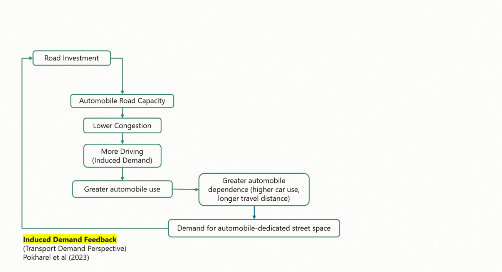
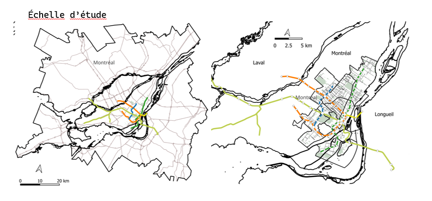

## 01 Pourquoi la dépendance à l’automobile se perpétue-t-elle? {#problem}

Newman et Kenworthy (2015) mettent en évidence les limites du modèle de mobilité urbaine fondé sur l’automobile, notamment à travers le concept de dépendance automobile [Newman & Kenworthy, 2015](#ref-newman2015). La réduction de cette dépendance suppose une meilleure articulation entre l’usage du sol, l’accessibilité et la localisation des activités économiques, afin de permettre aux populations de répondre à leurs besoins quotidiens sans recourir systématiquement à l’automobile ([Bertolini & le Clercq, 2003](#ref-bertolini2003)). Pourtant, la dépendance automobile persiste et elle s’explique notamment par les interactions entre transport et développement urbain : l’accessibilité automobile influence la localisation des activités, tandis que l’organisation spatiale qui en résulte contribue à renforcer le recours à la voiture.

{#fig-Media2_O1 width="85%" fig-align="center"}

À mesure que l’accessibilité automobile s’améliore, les ménages et les activités économiques s’établissent à des distances plus importantes les uns des autres, favorisant ainsi des formes de développement urbain plus dispersées. Cette dispersion spatiale entraîne à son tour une augmentation des distances de déplacement et renforce la dépendance à l’automobile. L’augmentation de l’usage de la voiture génère une demande accrue de capacité routière, à laquelle les pouvoirs publics peuvent répondre par l’élargissement des chaussées ou l’expansion des infrastructures routières, renforçant ainsi les conditions qui ont initialement favorisé un développement urbain orienté vers l’automobile. Les travaux sur les mécanismes de demande de transport ([Downs, 1998](#ref-downs1998); [Duranton & Turner, 2011](#ref-duranton2011); [Pokharel et al., 2023](#ref-pokharel2023)) et les travaux consacrés à l’allocation du sol ([Solow, 1973](#ref-solow1973); [Arnott & MacKinnon, 1978](#ref-arnott1978); [Kanemoto, 1977](#ref-kanemoto1977); [Millard-Ball, 2022](#ref-millardball2022)) mettent en évidence différentes dimensions de cette dynamique de rétroaction. Or, l’expansion du réseau routier implique des arbitrages dans l’allocation d’un espace urbain limité. Ainsi, la part croissante de la voirie consacrée à la circulation automobile réduit l’espace disponible pour les autres modes de transport et usages urbains. 

## 02 Une meilleure accessibilité entraîne-t-elle nécessairement une intensification urbaine? {#node-place}

Les deux boucles de rétroaction mettent en évidence le rôle complémentaire de la demande de transport et de l’aménagement de l’espace urbain dans le maintien de la dépendance à l’automobile. Si la demande de transport résulte des choix individuels de déplacement, la répartition de l’espace de voirie entre la circulation automobile, le stationnement, les infrastructures cyclables et les aménagements piétonniers découle directement des décisions d’aménagement. Les investissements en mobilité durable peuvent ainsi améliorer l’accessibilité sans nécessairement réduire l’avantage relatif de l’automobile ([Kamruzzaman, Baker et Turrell, 2015](#ref-kamruzzaman2015); [Morency et al., 2020](#ref-morency2020)). Alors dans quelle mesure les gains d’accessibilité en mobilité durable s’accompagnent-ils d’une intensification des activités urbaines ?

{#fig-node-place width="85%" fig-align="center"}

Le modèle nœud–lieu ([Bertolini, 1999](#ref-bertolini1999); [Chorus & Bertolini, 2011](#ref-chorus2011)) (Figure 2) permet d’examiner la relation entre l’accessibilité aux transports et le développement urbain.  qui caractérise les territoires selon deux dimensions : leur niveau d’accessibilité aux transports (valeur de nœud) et l’intensité du bâtit (valeur de lieu). Le modèle permet notamment d’identifier les secteurs où le niveau d’accessibilité est élevé, mais où le développement urbain demeure relativement faible. Toutefois, les gains d’accessibilité en mobilité durable pourraient ne pas se traduire par une intensification des activités urbaines si l’espace de voirie demeure largement consacré à l’automobile.

## 03 Lacunes de la littérature et objectifs de recherche {#gap}

**Lacunes de la littérature** 
*1. L’allocation de l’espace de voirie est une dimension distincte de l’accessibilité des transports durable et de la connectivité du réseau* : L’amélioration de l’accessibilité ne s’accompagne pas nécessairement d’une modification de la répartition de l’espace de voirie entre les différents modes de transport. Par exemple, l’implantation d’une nouvelle station de transport collectif peut accroître l’accessibilité sans réduire l’espace consacré à l’automobile, tandis que le remplacement d’une voie de circulation automobile par une piste cyclable protégée peut simultanément améliorer l’accessibilité à vélo et redistribuer l’espace de voirie. Plusieurs extensions du modèle nœud–lieu ont intégré des dimensions supplémentaires, notamment la configuration du réseau viaire 
([Lyu et al., 2016](#ref-lyu2016)), l’accessibilité en transport collectif et la densité des rues en impasse ([Kamruzzaman et al., 2014](#ref-kamruzzaman2014)), l’accessibilité cyclable ([Robillard et al., 2023](#ref-robillard2023)) et l’emploi ([Zemp et al., 2011](#ref-zemp2011)). Toutefois, ces indicateurs ne permettent pas de caractériser explicitement la répartition de l’espace de voirie entre les modes de transport, particulièrement la part consacrée à la circulation automobile.

*2. Des études longitudinales limitées sur les effets de la réallocation de l’espace de voirie sur le développement urbain* ; Les études qui portent sur la répartition de l’espace de voirie à Amsterdam ([Nello-Deakin, 2019](#ref-nellodeakin2019)), Fribourg ([Gössling et al., 2016](#ref-gossling2016)) et Montréal ([Lefebvre-Ropars, Morency & Negron-Poblete, 2021](#ref-lefebvre2021)) reposent principalement sur des analyses transversales. Parallèlement, les travaux sur le démantèlement d’autoroutes urbaines à Séoul et à San Francisco montrent que la transformation des infrastructures automobiles peut influencer les valeurs foncières et les caractéristiques des quartiers environnants ([Kang & Cervero, 2009](#ref-kang2009); [Cervero et al., 2009](#ref-cervero2009)). Les effets de la réallocation de l’espace consacré à l’automobile sur l’évolution du cadre bâti et des activités économiques le long des rues urbaines existantes demeurent peu documentés.

### Objectif général

L’objectif général de cette recherche est d’examiner comment la répartition de l’espace de voirie entre les différents modes de transport influence la relation entre l’accessibilité en mobilité durable et l’intensification urbaine. Plus précisément, il s’agit d’étudier dans quelle mesure les différences dans l’espace consacré à l’automobile et sa réallocation au fil du temps sont associées à des changements dans l’intensité du développement urbain.

Cette recherche s’articule autour de trois questions :
*Q1 Différences spatiales* La répartition de l’espace de voirie permet-elle de distinguer des territoires présentant des niveaux comparables d’accessibilité en mobilité durable et d’intensité du cadre bâti ? 
*Q2 Évolution dans le temps* La réallocation de l’espace consacré à l’automobile est-elle suivie de changements dans l’intensité du cadre bâti?
*Q3 Mesure* Est-il possible de reconstituer l’évolution de la répartition de l’espace de voirie entre les modes de transport avec une précision spatiale et temporelle suffisante pour étudier ces relations ?

::: panel-tabset
### O1 Caractériser

*Analyse transversale : région métropolitaine de Montréal*

1) Positionner les territoires selon leur niveau d’accessibilité en mobilité durable et l’intensité du développement urbain.

2) Examiner si la répartition des voies de circulation automobile permet de distinguer des territoires présentant des caractéristiques comparables.

{fig-align="center" width="85%"}

### O2 Évaluer

*Analyse longitudinale : réallocation de l’espace de voirie*

1)  Construire une base de données longitudinale annuelle des changements dans le nombre de voies de circulation.

2) Examiner les transformations de la voirie à proximité des stations du REM et des infrastructures cyclables.

3) Estimer dans quelle mesure les réaménagements de la voirie sont suivis de changements dans les activités économiques, les valeurs foncières et l’intensité du cadre bâti.

{fig-align="center" width="85%"}

### O3 Mesurer

*Reconstitution historique de l’aménagement de la voirie*

1) Combiner des images satellitaires et des données géospatiales complémentaires.

2) Reconstituer l’évolution de la répartition de l’espace de voirie afin de distinguer les voies de circulation automobile, les espaces de stationnement et les infrastructures cyclables.

{fig-align="center" width="85%"}
:::

## 04 References {#references}

::: {#ref-arnott1978}
1. Arnott, Richard J., et James G. MacKinnon. 1978. « Market and Shadow Land Rents with Congestion. » *The American Economic Review* 68 (4): 588.
:::

::: {#ref-bertolini2003}
2. Bertolini, Luca, et Frank le Clercq. 2003. « Urban Development without more Mobility by Car? Lessons from Amsterdam, a Multimodal Urban Region. » *Environment and Planning A: Economy and Space* 35 (4): 575–589. https://doi.org/10.1068/a3592.
:::

::: {#ref-cervero2009}
2. Cervero, Robert, Junhee Kang et Kevin Shively. 2009. « From elevated freeways to surface boulevards: neighborhood and housing price impacts in San Francisco. » *Journal of Urbanism: International Research on Placemaking and Urban Sustainability* 2 (1): 31‑50. https://doi.org/10.1080/17549170902833899.
:::

::: {#ref-chorus2011}
3. Chorus, Paul, et Luca Bertolini. 2011. « An application of the node-place model to explore the spatial development dynamics of station areas in Tokyo. » *Journal of Transport and Land Use* 4 (1): 45‑58. https://doi.org/10.5198/jtlu.v4i1.145.
:::

::: {#ref-downs1998}
4. Downs, Anthony. 1998. « Chapter 1: The Law of Peak-Hour Expressway Congestion. » 1‑17. Edward Elgar Publishing. https://doi.org/10.4337/9781035335329.00006.
:::

::: {#ref-duranton2011}
5. Duranton, Gilles, et Matthew A. Turner. 2011. « The Fundamental Law of Road Congestion: Evidence from US Cities. » *American Economic Review* 101 (6): 2616‑2652. https://doi.org/10.1257/aer.101.6.2616.
:::

::: {#ref-gossling2016}
6. Gössling, Stefan, Marcel Schröder, Philipp Späth et Tim Freytag. 2016. « Urban Space Distribution and Sustainable Transport. » *Transport Reviews* 36 (5): 659‑679. https://doi.org/10.1080/01441647.2016.1147101.
:::

::: {#ref-kamruzzaman2015}
7. Kamruzzaman, Liton, Douglas Baker et Gavin Turrell. 2015. « Do dissonants in transit oriented development adjust commuting travel behaviour? » *European Journal of Transport and Infrastructure Research* 15: 66‑77. https://doi.org/10.18757/ejtir.2015.15.1.3059.
:::

::: {#ref-kamruzzaman2014}
8. Kamruzzaman, Md., Douglas Baker, Simon Washington et Gavin Turrell. 2014. « Advance transit oriented development typology: case study in Brisbane, Australia. » *Journal of Transport Geography* 34: 54‑70. https://doi.org/10.1016/j.jtrangeo.2013.11.002.
:::

::: {#ref-kanemoto1977}
9. Kanemoto, Yoshitsugu. 1977. « Cost-benefit analysis and the second best land use for transportation. » *Journal of Urban Economics* 4 (4): 483‑503. https://doi.org/10.1016/0094-1190(77)90008-0.
:::

::: {#ref-kang2009}
10. Kang, Chang, et Robert Cervero. 2009. « From Elevated Freeway to Urban Greenway: Land Value Impacts of the CGC Project in Seoul, Korea. » *Urban Studies* 46: 2771‑2794. https://doi.org/10.1177/0042098009345166.
:::

::: {#ref-lefebvre2021}
11. Lefebvre-Ropars, Gabriel, Catherine Morency et Paula Negron-Poblete. 2021. « A needs-gap analysis of street space allocation. » *Journal of Transport and Land Use* 14 (1): 151‑170. https://doi.org/10.5198/jtlu.2021.1808.
:::

::: {#ref-lyu2016}
12. Lyu, Guowei, Luca Bertolini et Karin Pfeffer. 2016. « Developing a TOD typology for Beijing metro station areas. » *Journal of Transport Geography* 55: 40‑50. https://doi.org/10.1016/j.jtrangeo.2016.07.002.
:::

::: {#ref-millardball2022}
13. Millard-Ball, Adam. 2022. « The Width and Value of Residential Streets. » *Journal of the American Planning Association* 88 (1): 30‑43. https://doi.org/10.1080/01944363.2021.1903973.
:::

::: {#ref-morency2020}
14. Morency, Patrick, Céline Plante, Anne-Sophie Dubé, Sophie Goudreau, Catherine Morency, Pierre-Léo Bourbonnais, Naveen Eluru, Louis-François Tétreault, Marianne Hatzopoulou, Naveen Chandra Iraganaboina, Tanmoy Bhowmik et Audrey Smargiassi. 2020. « The Potential Impacts of Urban and Transit Planning Scenarios for 2031 on Car Use and Active Transportation in a Metropolitan Area. » *International Journal of Environmental Research and Public Health* 17: 5061. https://doi.org/10.3390/ijerph17145061.
:::

::: {#ref-nellodeakin2019}
15. Nello-Deakin, Samuel. 2019. « Is there such a thing as a ‘fair’ distribution of road space? » *Journal of Urban Design* 24 (5): 698‑714. https://doi.org/10.1080/13574809.2019.1592664.
:::

::: {#ref-newman2015}
16. Newman, Peter, et Jeffrey R. Kenworthy. 2015. *The End of Automobile Dependence: How Cities Are Moving beyond Car-Based Planning.* Washington, DC: Island Press. https://doi.org/10.5822/978-1-61091-613-4.
:::

::: {#ref-pokharel2023}
17. Pokharel, Ramesh, Eric J. Miller et Karen Chapple. 2023. « Modeling car dependency and policies towards sustainable mobility: A system dynamics approach. » *Transportation Research Part D: Transport and Environment* 125: 103978. https://doi.org/10.1016/j.trd.2023.103978.
:::

::: {#ref-robillard2023}
18. Robillard, Arianne, Geneviève Boisjoly et Dea Lierop. 2023. « Transit-oriented development and bikeability: Classifying public transport station areas in Montreal, Canada. » *Transport Policy* 148. https://doi.org/10.1016/j.tranpol.2023.12.012.
:::

::: {#ref-solow1973}
19. Solow, Robert. 1973. « Congestion Cost and the Use of Land for Streets. » *Bell Journal of Economics* 4 (2): 602‑618.
:::

::: {#ref-zemp2011}
20. Zemp, Stefan, Michael Stauffacher, Daniel J. Lang et Roland W. Scholz. 2011. « Classifying railway stations for strategic transport and land use planning: Context matters! » *Journal of Transport Geography* 19 (4): 670‑679. https://doi.org/10.1016/j.jtrangeo.2010.08.008.
:::
