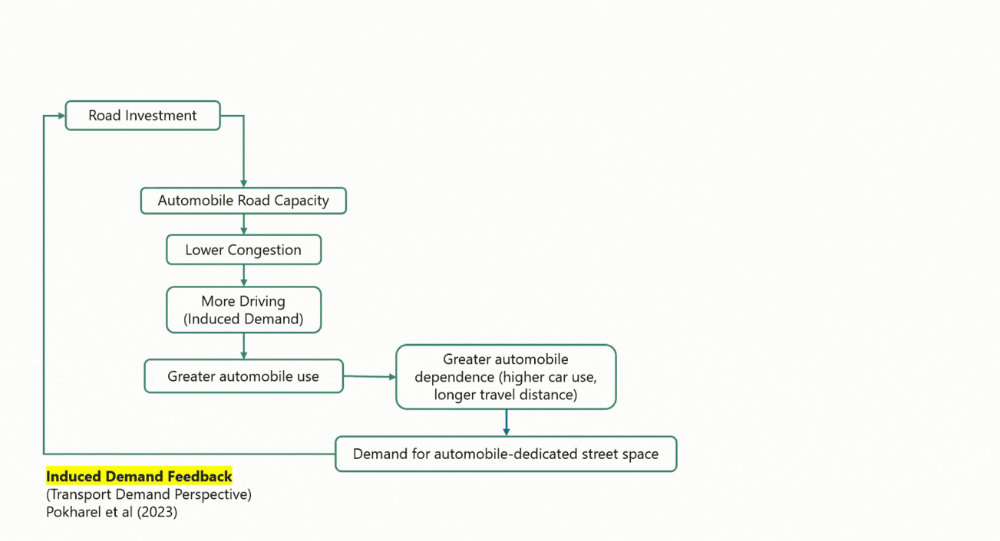
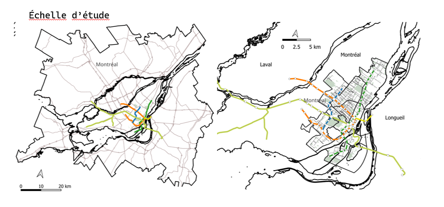

## 01 How does automobile dependence reinforce itself? {#problem}

Newman and Kenworthy frame the unsustainability of contemporary urban transport systems through the notion of automobile dependence (Newman & Kenworthy, 2015), emphasizing the need to better align land use, accessibility, and economic activity across modes so that everyday needs can be met with less reliance on private vehicles (Bertolini & le Clercq, 2003). Yet, if the need for such alignment is well established, why does automobile dependence remain so persistent? One explanation lies in the mutually reinforcing relationship between transport accessibility and urban development.

{#fig-Media2_O1 width="85%" fig-align="center"}

As automobile accessibility increases, households and economic activities can locate farther apart, encouraging more dispersed patterns of development. This spatial dispersion, in turn, increases travel distances and reinforces reliance on private vehicles. Growing automobile use generates additional demand for road capacity, which may be accommodated through road widening or the expansion of automobile infrastructure, further reinforcing the conditions that initially encouraged car-oriented development. Transport-side explanations (Downs, 1998; Duranton & Turner, 2011; Pokharel et al., 2023) and land-use-side explanations (Solow, 1973; Arnott & MacKinnon, 1978; Kanemoto, 1977; Millard-Ball, 2022) describe different dimensions of this feedback loop. Road expansion entails competing demands for limited urban space. As street space is limited, allocating a greater share to automobile traffic reduces the space available for other transport modes and urban uses, potentially constraining opportunities for urban intensification and greater proximity between activities.

## 02 Does greater accessibility necessarily lead to urban intensification? {#node-place}

The two reinforcing feedback loops suggest that reducing automobile dependence involves more than improving alternatives to driving. While transport demand emerges from individual travel decisions, the distribution of street space between automobile use and other transport modes, parking, cycling, and walking is directly shaped by planning decisions.Investments in sustainable transport can improve accessibility without necessarily reducing the relative advantage of automobiles (L. Kamruzzaman, Baker et Turrell 2015; Morency et al. 2020). Then, if improving sustainable accessibility is not sufficient to transform automobile-oriented urban environments, under what conditions does improved accessibility actually translate into urban intensification?

{#fig-node-place width="85%" fig-align="center"}

The relationship between transport accessibility and urban development can be further examined through the node–place model (Bertolini, 1999; Chorus & Bertolini, 2011) (Figure 1), which conceptualizes urban locations according to their transport accessibility (node value) and the intensity and diversity of surrounding activities (place value). The model suggests that imbalances between these dimensions may create pressures for adjustment, such as when high accessibility is not accompanied by corresponding urban intensity. However, enhancements in sustainable transportation accessibility may not yield the expected increase in activity if the surrounding streetscape remains dominated by car traffic.

## 03 The Research Gap and Objectives {#gap}

**Gap in the literature** 
*1. Street-space allocation is distinct from transport accessibility and network connectivity* : Improvements in accessibility do not necessarily involve changes in how street space is distributed among transport modes. For example, a new transit station may increase accessibility without reducing automobile-dedicated space, whereas replacing an automobile lane with protected cycling infrastructure can simultaneously improve cycling accessibility and redistribute street space. Extensions of the node–place model have incorporated additional dimensions of transport accessibility and urban form, including street-network design (Lyu et al., 2016), public transport accessibility and cul-de-sac density (Kamruzzaman et al., 2014), cycling accessibility (Robillard et al., 2023), and employment (Zemp et al., 2011). While these indicators characterize different aspects of accessibility and urban form, they do not explicitly distinguish how street space is allocated among transport modes, particularly the share dedicated to automobile circulation.

*2. Limited longitudinal evidence linking street-space reallocation to urban development* ; Existing studies measuring street-space allocation in Amsterdam (Nello-Deakin 2019), Freiburg (Gössling et al. 2016), and Montréal (Lefebvre-Ropars, Morency et Negron-Poblete 2021) are primarily cross-sectional. Meanwhile, studies of highway removals in Seoul and San Francisco show that transforming automobile-oriented infrastructure can influence surrounding property values, neighbourhood amenities, and residential attractiveness (Kang & Cervero, 2009; Cervero et al., 2009).Although these findings suggest that the allocation and transformation of automobile infrastructure may have implications beyond traffic circulation, they provide limited evidence on whether reallocations of automobile-dedicated space along existing urban local streets are followed by changes in built intensity and economic activity.

### General objectives

The general objective is to examine how the allocation of street space between transport modes shapes the relationship between sustainable transport accessibility and urban intensification, by investigating whether differences in automobile-dedicated space and its reallocation over time are associated with changes in the intensity of urban development.

The proposal identifies three open questions: 
*Q1 Spatial differences* Does street-space allocation distinguish locations with comparable levels of sustainable accessibility and built intensity? 
*Q2 Changes over time* Are reallocations of automobile-dedicated space followed by changes in built intensity, particularly where sustainable accessibility is already high? 
*Q3 Measurement* Can changes in the modal allocation of street space be reconstructed with sufficient spatial and temporal detail to investigate these relationships?

::: panel-tabset
### O1 Diagnose

*Cross-sectional analysis : Metropolitan Montréal*

1)  Position locations on an accessibility–intensity plane.
2)  Examine whether automobile lane allocation distinguishes otherwise comparable locations.

{fig-align="center" width="85%"}

### O2 Evaluate

*Longitudinal analysis : Street-space reallocation*

1)  Construct an annual panel of road lane changes.
2)  Examine changes near REM stations and cycling infrastructure
3)  Estimate whether street reconfigurations are followed by changes in economic activities, land values, built intensity

{fig-align="center" width="85%"}

### O3 Measure

*Historical Reconstruction of Street Environments*

1)  Combine satellite imagery and complementary geospatial data.
2)  Reconstruct changes in the allocation of street space in order to distinguish automobile traffic lanes, parking, and cycling facilities.

{fig-align="center" width="85%"}
:::

## 04 References {#references}

1. Arnott, Richard J., et James G. MacKinnon. 1978. « Market and Shadow Land Rents with Congestion. » The American Economic Review 68 (4): 588.

2. Cervero, Robert, Junhee Kang et Kevin Shively. 2009. « From elevated freeways to surface boulevards: neighborhood and housing price impacts in San Francisco. » Journal of Urbanism: International Research on Placemaking and Urban Sustainability 2 (1): 31‑50. https://doi.org/10.1080/17549170902833899.

3. Chorus, Paul, et Luca Bertolini. 2011. « An application of the node-place model to explore the spatial development dynamics of station areas in Tokyo. » Journal of Transport and Land Use 4 (1): 45‑58. https://doi.org/10.5198/jtlu.v4i1.145.

4. Downs, Anthony. 1998. « Chapter 1: The Law of Peak-Hour Expressway Congestion. » 1‑17. Edward Elgar Publishing. https://doi.org/10.4337/9781035335329.00006.

5. Duranton, Gilles, et Matthew A. Turner. 2011. « The Fundamental Law of Road Congestion: Evidence from US Cities. » American Economic Review 101 (6): 2616‑2652. https://doi.org/10.1257/aer.101.6.2616.

6. Gössling, Stefan, Marcel Schröder, Philipp Späth et Tim Freytag. 2016. « Urban Space Distribution and Sustainable Transport. » Transport Reviews 36 (5): 659‑679. https://doi.org/10.1080/01441647.2016.1147101.

7. Kamruzzaman, Liton, Douglas Baker et Gavin Turrell. 2015. « Do dissonants in transit oriented development adjust commuting travel behaviour? » European Journal of Transport and Infrastructure Research 15: 66‑77. https://doi.org/10.18757/ejtir.2015.15.1.3059.

8. Kamruzzaman, Md., Douglas Baker, Simon Washington et Gavin Turrell. 2014. « Advance transit oriented development typology: case study in Brisbane, Australia. » Journal of Transport Geography 34: 54‑70. https://doi.org/10.1016/j.jtrangeo.2013.11.002.

9. Kanemoto, Yoshitsugu. 1977. « Cost-benefit analysis and the second best land use for transportation. » Journal of Urban Economics 4 (4): 483‑503. https://doi.org/10.1016/0094-1190(77)90008-0.

10. Kang, Chang, et Robert Cervero. 2009. « From Elevated Freeway to Urban Greenway: Land Value Impacts of the CGC Project in Seoul, Korea. » Urban Studies 46: 2771‑2794. https://doi.org/10.1177/0042098009345166.

11. Lefebvre-Ropars, Gabriel, Catherine Morency et Paula Negron-Poblete. 2021. « A needs-gap analysis of street space allocation. » Journal of Transport and Land Use 14 (1): 151‑170. https://doi.org/10.5198/jtlu.2021.1808.

12. Lyu, Guowei, Luca Bertolini et Karin Pfeffer. 2016. « Developing a TOD typology for Beijing metro station areas. » Journal of Transport Geography 55: 40‑50. https://doi.org/10.1016/j.jtrangeo.2016.07.002.

13. Millard-Ball, Adam. 2022. « The Width and Value of Residential Streets. » Journal of the American Planning Association 88 (1): 30‑43. https://doi.org/10.1080/01944363.2021.1903973.

14. Morency, Patrick, Céline Plante, Anne-Sophie Dubé, Sophie Goudreau, Catherine Morency, Pierre-Léo Bourbonnais, Naveen Eluru, Louis-François Tétreault, Marianne Hatzopoulou, Naveen Chandra Iraganaboina, Tanmoy Bhowmik et Audrey Smargiassi. 2020. « The Potential Impacts of Urban and Transit Planning Scenarios for 2031 on Car Use and Active Transportation in a Metropolitan Area. » International Journal of Environmental Research and Public Health 17: 5061. https://doi.org/10.3390/ijerph17145061.

15. Nello-Deakin, Samuel. 2019. « Is there such a thing as a ‘fair’ distribution of road space? » Journal of Urban Design 24 (5): 698‑714. https://doi.org/10.1080/13574809.2019.1592664.

16. Newman, Peter, et Jeffrey R. Kenworthy. 2015. The End of Automobile Dependence: How Cities Are Moving beyond Car-Based Planning. Washington, DC: Island Press. https://doi.org/10.5822/978-1-61091-613-4.

17. Pokharel, Ramesh, Eric J. Miller et Karen Chapple. 2023. « Modeling car dependency and policies towards sustainable mobility: A system dynamics approach. » Transportation Research Part D: Transport and Environment 125: 103978. https://doi.org/10.1016/j.trd.2023.103978.

18. Robillard, Arianne, Geneviève Boisjoly et Dea Lierop. 2023. « Transit-oriented development and bikeability: Classifying public transport station areas in Montreal, Canada. » Transport Policy 148. https://doi.org/10.1016/j.tranpol.2023.12.012.

19. Solow, Robert. 1973. « Congestion Cost and the Use of Land for Streets. » Bell Journal of Economics 4 (2): 602‑618.

20. Zemp, Stefan, Michael Stauffacher, Daniel J. Lang et Roland W. Scholz. 2011. « Classifying railway stations for strategic transport and land use planning: Context matters! » Journal of Transport Geography 19 (4): 670‑679. https://doi.org/10.1016/j.jtrangeo.2010.08.008.
